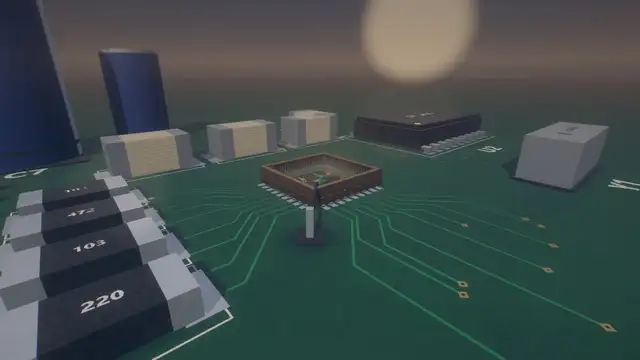
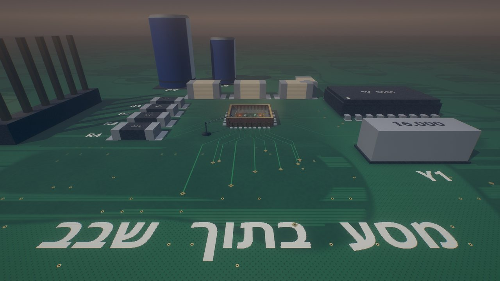
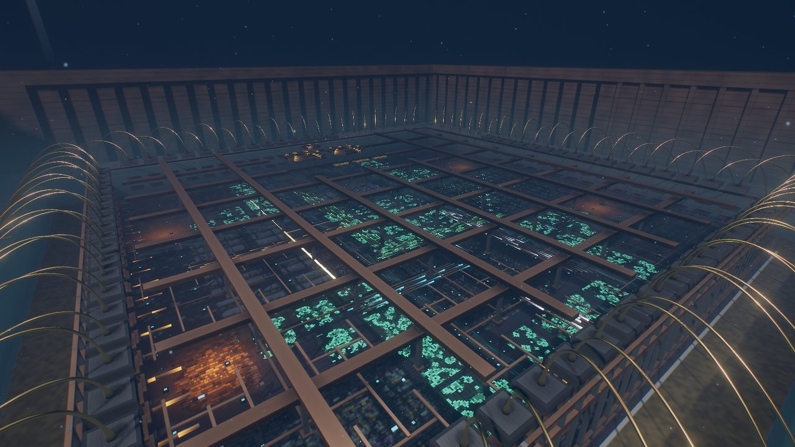
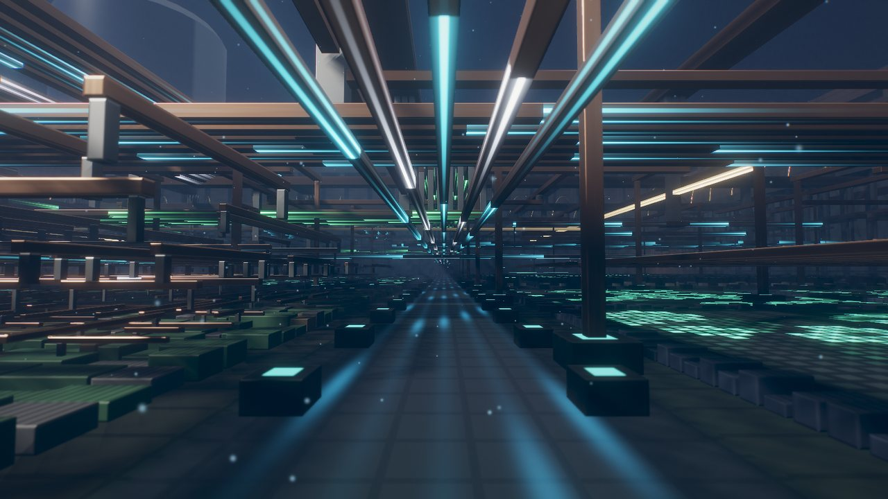
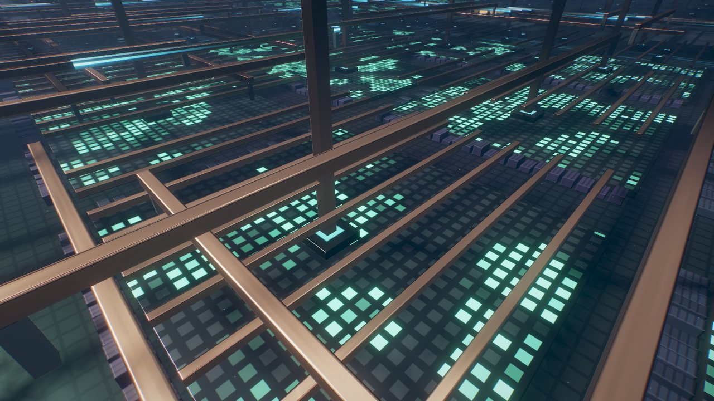
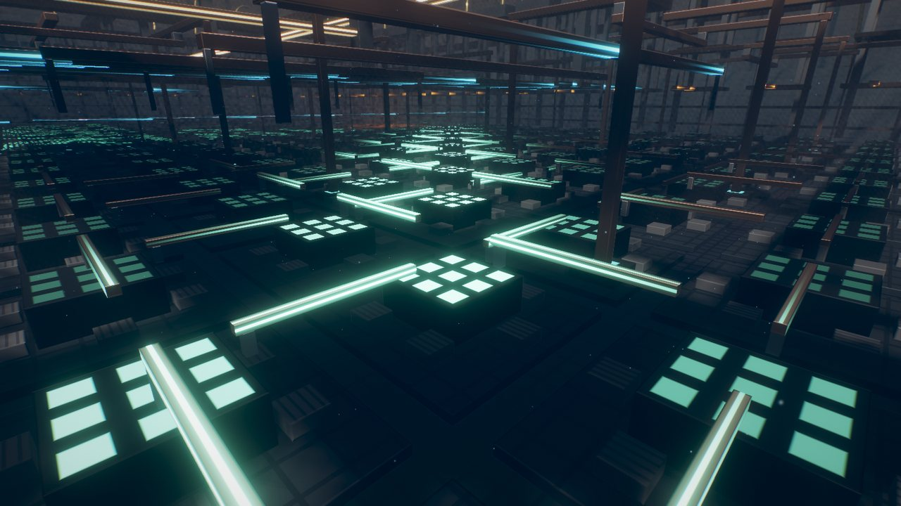
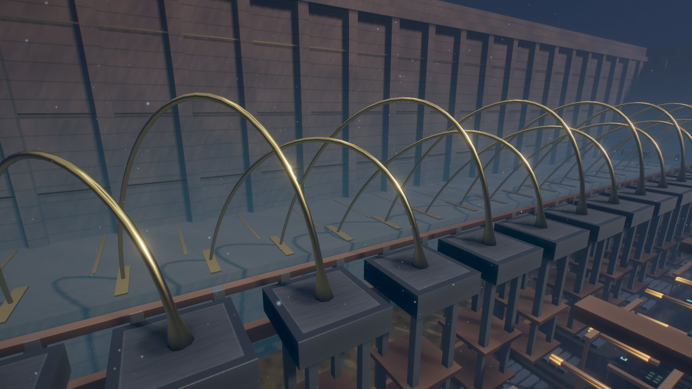
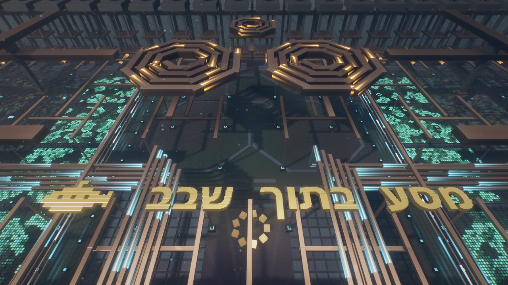
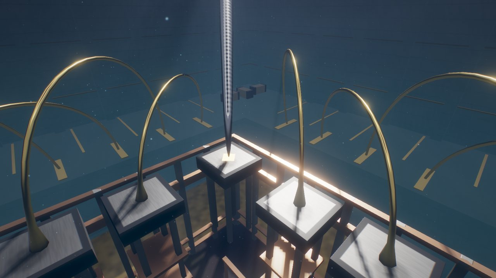

# 🔬 מסע בתוך שבב · Silicon Voyage

> מתחילים מעל לוח מעגל, טסים פנימה אל השבב, וצוללים עוד קומה: לתוך טרנזיסטור אחד, בין האטומים.<br>
> Start above a circuit board, fly into the chip, then dive one step further: inside a single transistor, among the atoms.

**[▶ להפעלה בדפדפן · Run it in your browser](https://beniabot.github.io/silicon-voyage/)**

[](https://beniabot.github.io/silicon-voyage/)



**[עברית](#עברית) · [English](#english)**

---

<div dir="rtl">

## עברית

מסע אחד דרך שלושה קני מידה, בקובץ HTML אחד של פחות מ־100 קילובייט.<br>
אין בו תמונות, אין מודלים, אין קובצי קול. הכול נבנה מקוד, מחדש, בכל טעינה.

### ⚡ איך מפעילים

* **בדפדפן** - נכנסים ל[קישור](https://beniabot.github.io/silicon-voyage/) ולוחצים "יוצאים לדרך", או "סיור מודרך".
* **בלי אינטרנט** - מורידים את [`index.html`](index.html) ופותחים אותו.
* **מה צריך** - כרום או אדג' עדכניים במחשב. הדפדפן צריך לתמוך ב־WebGPU.

### 🧭 שלושה קני מידה

* **הלוח** - מבחוץ השבב הוא קופסה קטנה על לוח ירוק. הקבלים והנגדים שסביבו נראים כמו מגדלים, והמנורות של החדר הן כתמי אור בשמיים.
* **השבב** - מעל הקיר ופנימה: עיר של נחושת ואור תחת מיקרוסקופ.
* **הטרנזיסטור** - מקש <kbd>Z</kbd> צולל לתוך טרנזיסטור אחד: גביש סיליקון אינסופי ואלקטרונים שזורמים בו.

הסיור המודרך עובר בכולם ברצף אחד, כארבע דקות: מהלוח, מעל קיר המארז, דרך השבב, צלילה לגביש, וחזרה החוצה.



### 🏙️ מה יש בשבב

* **ארבע ליבות** - זהות ובהשתקפות מראה, כמו בשבב אמיתי. יחידות הביצוע מתחממות ומאירות בכתום.
* **מטמון חי** - כל ביט הוא נורה, והנורות מתחלפות לפי "משחק החיים" של קונוויי.
* **מאיץ בינה מלאכותית** - 120 מעבדים זעירים, וגל של אור שעובר עליהם באלכסון.
* **עץ השעון** - כל 1.6 שניות יוצא הבזק מהמרכז ומגיע לכל 256 הקצוות יחד. הצליל מתקתק איתו.
* **רחובות נתונים** - פסי אור רצים בתוך מסילות נחושת, ואוטובוס טבעתי ירוק מקיף את המטמון.
* **חוטי הזהב** - 88 קשתות יוצאות מהשבב אל המארז. בפינה נוגעת בו מחט בדיקה.
* **הכתובת** - "מסע בתוך שבב" חרוט בזהב מעל הסלילים, ולידו צוללת קטנה, כמו הציורים הזעירים שמתכננים מחביאים בשבבים אמיתיים.

| | |
|---|---|
|  |  |
|  |  |
|  |  |

### ⚛️ בתוך הטרנזיסטור

* **גביש הסיליקון** - סריג אינסופי של אטומים. אפשר לטוס בתעלות שלו בלי להגיע לקצה.
* **השער** - מעל הגביש שכבת זכוכית בלי סדר, ומעליה המתכת.
* **האלקטרונים** - בכל פעימת שעון השער נפתח, ונהר זהוב שוטף את הערוץ.
* **פרטים קטנים** - האטומים רועדים מחום. פה ושם חסר אטום, ופה ושם זוהר אטום זרחן כתום.

| | |
|---|---|
|  |  |

### 🎮 שליטה

| מקש | פעולה |
|---|---|
| עכבר | להסתכל (לחיצה נועלת את העכבר) |
| `W` `A` `S` `D` | לשוט לאן שמסתכלים |
| `E` / `Q` | למעלה ולמטה |
| `Shift`, גלגלת | מהר, וכיוון המהירות |
| `Z` | לצלול לתוך טרנזיסטור, ולחזור |
| `1` עד `0` | עשר תחנות (ועוד אחת בתפריט: הלוח מבחוץ) |
| `F` | סיור אוטומטי |
| `P` | לשמור צילום |
| `M`, `H`, `Esc` | השתקה, הסתרת כיתובים, תפריט |

כדי לצאת מהשבב פשוט טסים למעלה, מעל הקיר. ככל שמתרחקים, הטיסה נעשית מהירה יותר.<br>
בתפריט: שלוש רמות איכות, עומק שדה, צליל ושפה. במסך מגע: חצי שמאלי לתנועה, חצי ימני למבט.

### 🧩 איך זה בנוי

* **הכול קופסאות** - כ־46,000 קופסאות בפקודת ציור אחת. הקודקודים לא שמורים בשום מקום.
* **הכרטיס הגרפי בוחר** - בכל פריים כל קופסה בודקת אם היא נראית וגדולה מכמה פיקסלים. מה שמתרחק נעשה דק ונעלם בלי לקפוץ.
* **עולם אחד רציף** - הלוח והשבב הם אותו עולם, באותן יחידות. הערפל, מרחק הציור ומהירות הטיסה נפתחים ככל שמתרחקים מהמארז.
* **שום דבר לא זז** - הפולסים, הבזק השעון והגל במאיץ מחושבים בתוך הצבע של החוטים, מתוך הזמן.
* **אור** - שתי מפות צל ותאורה רכה נאפות פעם אחת בטעינה. מעליהן ערפל, קרני אור והילה.
* **מיקרוסקופ** - עומק שדה עם מיקוד אוטומטי, שעוקב אחרי מה שמסתכלים עליו.
* **מתכת** - הנחושת והזהב משקפים סביבה שמחושבת בנוסחה: כיפת המיקרוסקופ, טבעת הנורות וזוהר העיר.
* **הגביש** - לא שמור בשום מקום. מצוירים רק התאים שסביב המצלמה, ולכן אין לו סוף.
* **הכתובות** - הדפדפן מצייר את המילים בגופן של המחשב, וכל קו הופך לקופסה. אפס בתים של גופן בקובץ.
* **צליל** - מסונתז בזמן אמת: זמזום, אקורד רך, תקתוק השעון וציוצי נתונים.
* **ביצועים** - הרזולוציה מתכווננת לבד. 60 פריימים בשנייה ב־1920×1080 על כרטיס Intel מובנה.

### 🛠️ בנייה ובדיקה

</div>

```bash
npm install
node build.mjs                                   # index.html, minified
node tools/shoot.mjs                             # screenshots of the stations
node tools/shoot.mjs --tour 20                   # frames along the tour, evenly spaced in time
node tools/shoot.mjs --bench --w 1920 --h 1080   # 45 s flight, GPU timings
node tools/shoot.mjs --check                     # collisions, audio level, focus
```

<div dir="rtl">

הכלים מריצים את העולם בכרום נפרד ונסתר, ושומרים את הצילומים בתיקייה `shots`.

### 💡 איך זה נעשה

* **הרעיון** - מתכון קטן שבונה עולם גדול. הקובץ לא מכיל את העולם, רק את ההוראות לבנות אותו.
* **השיטה** - לבנות, לצלם מתחנות קבועות ולאורך מסלול, לתת למבקר שרואה רק תמונות, לתקן, ולמדוד ביצועים על המחשב שהעולם אמור לרוץ עליו.
* **מי כתב** - וייב קודינג מלא, עם Claude.
* **רישיון** - [MIT](LICENSE): מותר להשתמש, לשנות ולהפיץ.

> 📌 **שורה תחתונה:** פחות מ־100 קילובייט, שלושה קני מידה, אפס קבצים מצורפים. תלחצו על הקישור ותטוסו.

</div>

---

## English

One voyage through three scales, in a single HTML file of under 100 KB.<br>
No images, no models, no sound files. Everything is built from code, from scratch, on every load.

### ⚡ Try it

* **In the browser** - open the [live page](https://beniabot.github.io/silicon-voyage/) and press "Set off", or "Guided tour".
* **Offline** - download [`index.html`](index.html) and open it.
* **You need** - a recent Chrome or Edge on a desktop. The browser must support WebGPU.

### 🧭 Three scales

* **The board** - from outside, the chip is a small box on a green board. The capacitors and resistors around it look like towers, and the lamps of the room are discs of light in the sky.
* **The chip** - over the wall and in: a city of copper and light under a microscope.
* **The transistor** - press <kbd>Z</kbd> to dive into a single transistor: an endless silicon crystal with electrons streaming through it.

The guided tour goes through all of them in one unbroken flight of about four minutes: from the board, over the package wall, through the chip, down into the crystal, and back out.

### 🏙️ What is in the chip

* **Four cores** - identical and mirrored, as in a real chip. The execution units run hot and glow orange.
* **A living cache** - every bit is a lamp, and the lamps follow Conway's Game of Life.
* **An AI accelerator** - 120 tiny processors, and a wave of light sweeping them diagonally.
* **The clock tree** - every 1.6 seconds a flash leaves the centre and reaches all 256 leaves together. The sound ticks with it.
* **Data streets** - strips of light run inside copper rails, and a green ring bus circles the cache.
* **Gold wires** - 88 arches leave the chip for the package. In one corner a probe needle touches it.
* **The inscription** - "מסע בתוך שבב" (a voyage inside a chip) etched in gold above the coils, with a tiny submarine beside it, like the little drawings designers hide in real chips.

### ⚛️ Inside the transistor

* **The silicon crystal** - an endless lattice of atoms. Fly down its channels and never reach an edge.
* **The gate** - above the crystal lies a layer of glass with no order, and above that the metal.
* **The electrons** - on every clock beat the gate opens, and a golden river floods the channel.
* **Small things** - the atoms tremble with heat. Here and there one is missing, and here and there an orange phosphorus atom glows.

### 🎮 Controls

| Key | Action |
|---|---|
| Mouse | Look around (click to lock the pointer) |
| `W` `A` `S` `D` | Fly where you look |
| `E` / `Q` | Up and down |
| `Shift`, wheel | Fast, and set your speed |
| `Z` | Dive into a transistor, and come back |
| `1` to `0` | Ten stations (and one more in the menu: the board outside) |
| `F` | Automatic tour |
| `P` | Save a picture |
| `M`, `H`, `Esc` | Mute, hide the labels, menu |

To leave the chip, just fly up and over the wall. The further out you are, the faster you fly.<br>
The menu has three quality levels, depth of field, sound and language. On a touch screen: left half moves, right half looks.

### 🧩 How it works

* **Everything is a box** - about 46,000 boxes in one draw call. No vertices are stored anywhere.
* **The GPU chooses** - every frame each box tests whether it is in view and bigger than a few pixels. What recedes grows thin and disappears without popping.
* **One continuous world** - the board and the chip are the same world in the same units. Haze, draw distance and flying speed open up as you leave the package.
* **Nothing moves** - the pulses, the clock flash and the accelerator's wave are computed inside the colour of the wires, from time alone.
* **Light** - two shadow maps and soft ambient light are baked once at load. On top: haze, light shafts and bloom.
* **Microscope** - depth of field with autofocus that follows whatever you look at.
* **Metal** - copper and gold mirror an environment made by a formula: the microscope's dome, its ring of LEDs, the glow of the city below.
* **The crystal** - stored nowhere. Only the cells around the camera are drawn, so it never ends.
* **The lettering** - the browser draws the words with the system font and every stroke becomes a box. Zero bytes of font in the file.
* **Sound** - synthesised live: a hum, a soft chord, the clock's tick, data chirps.
* **Performance** - the resolution adjusts itself. 60 frames per second at 1920×1080 on integrated Intel graphics.

### 🛠️ Build and test

```bash
npm install
node build.mjs                                   # index.html, minified
node tools/shoot.mjs                             # screenshots of the stations
node tools/shoot.mjs --tour 20                   # frames along the tour, evenly spaced in time
node tools/shoot.mjs --bench --w 1920 --h 1080   # 45 s flight, GPU timings
node tools/shoot.mjs --check                     # collisions, audio level, focus
```

The tools run the world in a separate, hidden Chrome and save the pictures in `shots`.

### 💡 How it was made

* **The idea** - a small recipe that builds a big world. The file does not hold the world, only the instructions for building it.
* **The method** - build, photograph from fixed stations and along a path, hand the pictures to a critic who sees nothing else, fix, and measure performance on the machine the world is meant to run on.
* **Who wrote it** - vibe coding all the way, with Claude.
* **License** - [MIT](LICENSE): use it, change it, share it.

> 📌 **Bottom line:** under 100 KB, three scales, zero attached files. Click the link and fly.
